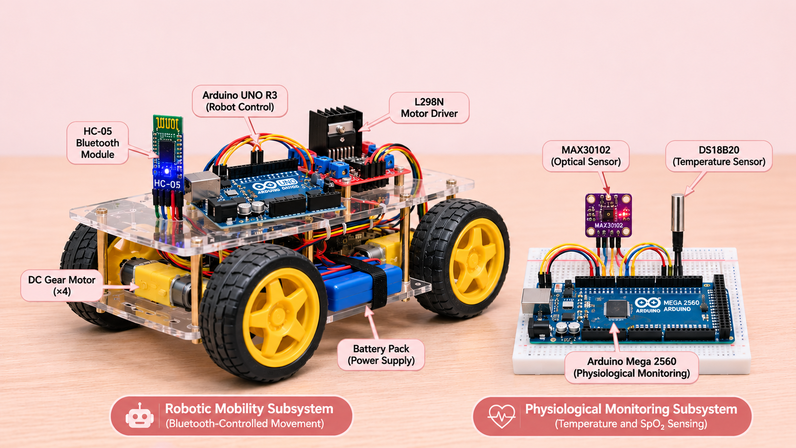

# Smart Medical Assistance Robot

*Figure 1. Conceptual hardware visualization of the robotic mobility and physiological monitoring subsystems. This is an illustrative rendering, not a photograph of the assembled prototype.*

An Arduino-based biomedical robotics prototype
integrating Bluetooth-controlled mobility,
physiological sensing, and embedded systems.

## Project Overview

This repository documents a four-wheel robotic
platform with Bluetooth-based movement control
and a separate physiological monitoring subsystem.

The implementation uses Arduino microcontrollers,
an L298N motor driver, an HC-05 Bluetooth module,
a MAX30102 optical sensor, and a DS18B20
temperature sensor.

The project is presented as an educational
engineering prototype rather than a clinically
validated medical device.

## System Architecture

### Robotic Mobility

Smartphone Controller
        |
        v
HC-05 Bluetooth
        |
        v
Arduino UNO
        |
        v
L298N Motor Driver
        |
        v
Four DC Motors

### Physiological Monitoring

MAX30102 ----+
             |
             v
        Arduino Mega
             ^
             |
DS18B20 -----+
             |
             v
     Serial / Bluetooth Output

## Hardware

| Component | Purpose |
|---|---|
| Arduino UNO R3 | Robot movement control |
| Arduino Mega 2560 | Physiological monitoring |
| L298N | Motor direction and PWM control |
| HC-05 | Bluetooth serial communication |
| MAX30102 | Optical sensing and SpO2 estimation |
| DS18B20 | Temperature sensing |
| DC gear motors | Robot movement |
| Batteries | Portable power supply |

See:
- hardware/components.md
- hardware/pin_connections.md
- hardware/bill_of_materials.csv

## Firmware

### Robot Control

File:
firmware/robot_control/robot_control.ino

Implements Bluetooth commands for forward,
backward, left, right, and stop operations,
together with predefined PWM speed settings.

### Physiological Monitoring

File:
firmware/physiological_monitoring/physiological_monitoring.ino

Reads DS18B20 temperature values and collects
MAX30102 optical samples for SpO2 estimation.

Important: The original firmware displays
simulated BPM values generated using random(70, 93).
These values are not measured heart rates.

## Documentation

| Document | Description |
|---|---|
| docs/system_architecture.md | System architecture |
| docs/methodology.md | Implementation methodology |
| docs/experimental_results.md | Reported observations |
| docs/limitations.md | Limitations and future work |
| docs/reproduction_guide.md | Hardware and software setup |

## Reproducibility

The source code is provided for technical
documentation and educational investigation.

Successful compilation, physical reproduction,
and clinical validation have not been independently
established.

A DS18B20 pin discrepancy exists between the
original report wiring table and firmware.

Consult the reproduction guide before attempting
hardware assembly.

## Evidence and Results

The source report describes:
- Bluetooth-controlled robotic movement
- Temperature monitoring
- MAX30102 optical sensor integration
- Serial/Bluetooth monitoring output

No systematic clinical accuracy or quantitative
communication-performance benchmarks are supplied.

## Safety and Limitations

This prototype is not a certified medical device.

It must not be used for clinical diagnosis,
emergency decision-making, or patient monitoring.
## License

The repository includes an MIT LICENSE file.
Third-party and jointly authored materials remain
subject to their respective ownership and permissions.
